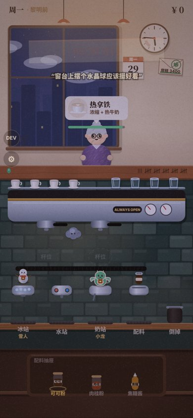
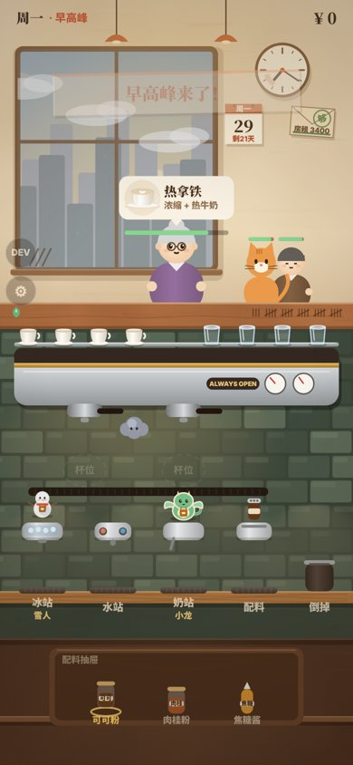
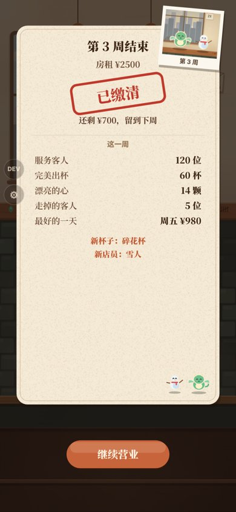

# 正常营业咖啡店 · Always Open Café

一个在手机浏览器里玩的小咖啡店游戏：清晨五点半开门，给客人做咖啡，按周交房租，50 天后房东奶奶要来收一大笔钱。店里会陆续来一些不太寻常的客人，它们最后会变成店里的可爱店员。

当前版本：**v3.1**　·　在线玩：https://johnik3.github.io/normal-cafe/

| 清晨开门 | 早高峰 | 每周合影 |
|---|---|---|
|  |  |  |

## 怎么玩

- **开门**：按住卷帘门往上拉，再点门口进店。
- **做咖啡**：
  - 从托盘拿杯子，拖到萃取头下面接浓缩。
  - 再把杯子拖去冰站、水站、奶站、配料站。
  - 杯口先冒出一颗淡淡的小星，等小星星跳出来时点一下，就是完美。
- **出杯**：做好后把杯子往上甩给客人。连续完美会有连击，小费更多。
- **一周的节奏**：每天营业到上午十点；每周日交房租；打烊后可以去商店买设备、翻新店面、摆件和杯子。
- **店员**：有几位客人会反复来访，之后入职。在岗的店员会接手对应的那一步，杯子划过去就完成。人到齐以后，可以一笔划完整杯。
- **第 50 天**：房东奶奶会亲自来。

## 运行

整个游戏就是一个文件 `index.html`，不需要安装或构建：

- 直接用浏览器打开 `index.html`；
- 或者在仓库的 Settings → Pages 里，把 `main` 分支的根目录设为来源，用手机打开生成的网址。

进度存在浏览器本地（localStorage）。右上角的菜单按钮可以开关音乐、音效、震动，选择画质，看图鉴和相册，或者重新开始；营业时打开菜单会暂停。

开发者面板默认隐藏，在网址后面加 `?dev`（比如 `index.html?dev`）就会出现 DEV 按钮，可以直接跳到各个节点。

## 画质

v3.0 的画面有水粉笔触、光影和纸纹，比以前吃性能。画质有三档：

- **自动**（默认）：营业时如果连续 3 秒低于 40 帧，就降一档。
- **高**：始终全部特效。
- **省电**：去掉角色笔触、光束、灰尘和纸纹。

## 目录

```
index.html          游戏本体（HTML5 Canvas + 原生 JS + Web Audio 合成音）
docs/design.md      当前设计说明
docs/screenshots/   截图
tests/              Playwright 自动测试脚本（见 tests/README.md）
CHANGELOG.md        版本记录
```

## 测试

见 [tests/README.md](tests/README.md)。v3.0 发布前跑过：

- 三种玩家水平的 50 天完整模拟；
- 第 1、5、20 天的教学；
- 全部 DEV 跳转节点；
- BOSS 战；
- 375×667 和 360×640 两种小屏。
